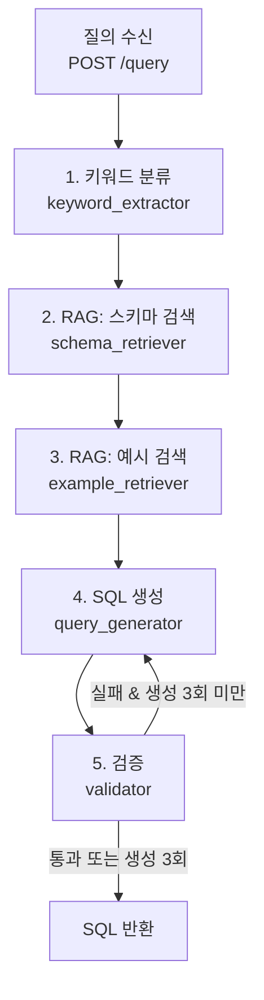

# NL2SQL 동작 흐름

nl2sql 서비스가 자연어 질의를 받아 SQL을 돌려주기까지의 과정을 정리한 문서다.

## 흐름도



| 단계 | 하는 일 | 사용하는 것 | 결과 (State) |
|---|---|---|---|
| 1. 키워드 분류 | 질의에서 카테고리·제조사·가격·스펙·프로그램 추출 | LLM | `keywords` |
| 2. 스키마 검색 | 질의와 관련된 테이블 스키마 5개 검색 | 벡터 DB | `schema_info` |
| 3. 예시 검색 | 비슷한 질문-SQL 예시 3개 검색 | 벡터 DB | `query_example` |
| 4. SQL 생성 | 1~3의 결과와 질의로 SQL 작성 | LLM | `query`, `retry_count` |
| 5. 검증 | 금지어 검사 + `EXPLAIN` 실행 | MySQL | `error` |

## 0. 질의 수신


`POST /query`로 질의를 받아 그래프를 실행한다. 

```json
{ "question": "VRAM 16GB 이상 MSI 그래픽카드 100만원 이하" }
```


## 1. 키워드 분류 — keyword_extractor

[nl2sql/src/nodes/keyword_extractor.py](../nl2sql/src/nodes/keyword_extractor.py)

LLM이 질의를 읽고 키워드를 분류해 `keywords`에 저장한다. 질의에 없는 항목은 빈 값(`null`, `[]`)이다.

| 키 | 내용 | 예시 |
|---|---|---|
| `categories` | 부품 카테고리. CPU, MAINBOARD, RAM, GPU, POWER, SSD, HDD, MONITOR 중 하나 | `["GPU"]` |
| `brands` | 제조사 | `["MSI"]` |
| `price` | `{min, max}`, 원 단위 정수 | "100만원 이하" → `{"min": null, "max": 1000000}` |
| `specs` | `{name, operator, value}` 목록 | "VRAM 16GB 이상" → `{"name": "VRAM", "operator": ">=", "value": "16GB"}` |
| `program` | PC로 사용하려는 게임·프로그램 | "롤 할 때 필요한 스펙" → `["롤"]` |

분류한 키워드는 4단계 SQL 생성 프롬프트에 참고용으로 들어간다.

## 2~3. RAG — 스키마·예시 검색

[nl2sql/tools/retriever.py](../nl2sql/tools/retriever.py)

 SQL을 만들기 전에 필요한 정보를 벡터 DB에서 찾아 프롬프트에 넣는다.

### 벡터 DB

- **저장소**: ChromaDB (`nl2sql/vectordb/`)
- **임베딩 모델**: `BAAI/bge-m3`

| 컬렉션 | 원본 데이터 | 저장 방식 |
|---|---|---|
| `schema_collection` | [data/schema_docs.json](../nl2sql/data/schema_docs.json) | 테이블 하나당 문서 하나 (테이블·컬럼 설명 JSON) |
| `fewshot_collection` | [data/few_shot_examples.json](../nl2sql/data/few_shot_examples.json) | 질문을 임베딩하고, SQL은 metadata에 저장 |

서버가 시작할 때 `init_vector_db_if_need()`가 컬렉션이 비어 있을 때만 json 파일을 적재한다.

### 2. 스키마 검색 — schema_retriever

[nl2sql/src/nodes/schema_retriever.py](../nl2sql/src/nodes/schema_retriever.py) → `get_schema()`

질의와 관련된 테이블 스키마 **5개**를 가져와 `schema_info`에 저장한다.

- `modules`, `categories` 2개는 질의와 관계없이 **항상 포함**한다. 제품명·제조사·가격이 `modules`에만 있기 때문이다.
- 나머지 3개는 두 테이블을 제외하고 질의 원문과의 유사도로 검색한다.

| 질의 | 가져오는 테이블 |
|---|---|
| VRAM 16GB 이상 그래픽카드 가격 | categories, modules + graphic_cards, rams, main_boards |
| 라이젠5 7500F와 호환되는 메인보드 | categories, modules + main_boards, cpus, graphic_cards |

### 3. 예시 검색 — example_retriever

[nl2sql/src/nodes/example_retriever.py](../nl2sql/src/nodes/example_retriever.py) → `get_examples()`

질의와 비슷한 질문 **3개**와 그 SQL을 가져와 `query_example`에 저장한다. 4단계에서 few-shot 예시로 쓴다.

```
Question: VRAM 16GB 이상인 그래픽카드를 가격 낮은 순으로 보여줘
SQL: SELECT ...
```

## 4. SQL 생성 — query_generator

[nl2sql/src/nodes/query_generator.py](../nl2sql/src/nodes/query_generator.py)

LLM(Groq `openai/gpt-oss-120b`, temperature 0)에 다음을 넣어 SQL을 만든다.

- 2단계의 스키마
- 3단계의 예시
- 질의 원문
- 1단계의 키워드

주요 규칙은 다음과 같다.

- SELECT만 작성한다 (INSERT/UPDATE/DELETE/DROP 금지).
- 스키마에 없는 테이블·컬럼은 쓰지 않는다.
- 부품 조회는 항상 `modules`를 조인하고, `modules`의 모든 컬럼을 SELECT에 포함한다.
- 개수 제한이 있는 질의에만 `LIMIT`을 쓴다.
- 키워드는 참고용이다. 질의 원문과 다르면 원문을 따른다.

생성할 때마다 `retry_count`가 1씩 늘어난다. 재시도일 때는 이전 SQL과 오류 내용을 프롬프트에 추가해 고치게 한다.

## 5. 검증 — validator

[nl2sql/src/nodes/validator.py](../nl2sql/src/nodes/validator.py), [nl2sql/tools/db_executor.py](../nl2sql/tools/db_executor.py) → `validate_sql()`

다음 순서로 검사하고, 실패하면 `error`에 사유를 기록한다.

1. 쿼리가 비어 있지 않은지
2. `SELECT` 또는 `WITH`로 시작하는지
3. `INSERT`, `UPDATE`, `DELETE`, `DROP`이 포함되지 않았는지
4. MySQL에서 `EXPLAIN <SQL>`이 성공하는지 (문법, 테이블·컬럼 존재 여부)

`EXPLAIN`은 실행 계획만 확인하므로 데이터를 읽거나 바꾸지 않는다.

### 재시도 분기

[nl2sql/src/graph.py](../nl2sql/src/graph.py) `route_after_validation()`

| 조건 | 다음 단계 |
|---|---|
| `error`가 비어 있음 (통과) | 종료 |
| `retry_count`가 3 이상 | 종료 (마지막 `error`를 담아 반환) |
| 그 외 | 4단계로 돌아가 다시 생성 |

## 6. 응답

```json
{
  "query": "SELECT m.module_id, ... FROM modules m JOIN graphic_cards g ON ... WHERE ...",
  "error": "",
  "retry_count": 1
}
```

`error`가 빈 문자열이면 성공이다. nl2sql은 SQL을 만들기만 하고, 실제 조회는 이 SQL을 받은 백엔드가 한다.

## 알아둘 점

- **LLM 호출 횟수**: 질의 하나당 키워드 분류 1번 + SQL 생성 1~3번이다.
- **MySQL 필요**: 검증에서 `EXPLAIN`을 실행하므로 MySQL이 꺼져 있으면 모든 질의가 3번 재시도한 뒤 실패한다.
- **실행 위치**: `./vectordb`, `data/*.json`을 상대 경로로 열기 때문에 로컬에서는 `nl2sql/` 폴더에서 실행해야 한다.
- **필수 테이블 필터**: `modules`, `categories`는 문서 안의 `"table": "modules"` 문자열로 찾는다. 스키마 문서를 적재하는 `json.dumps` 형식을 바꾸면 필터가 동작하지 않을 수 있다.
