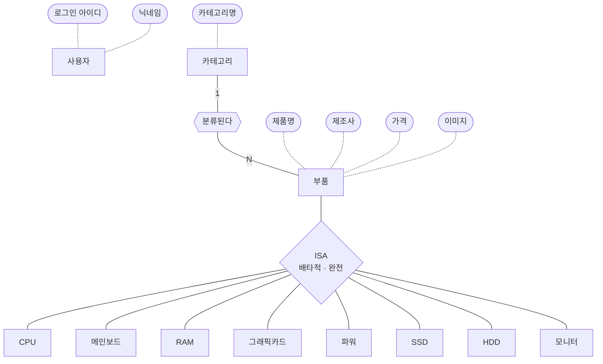
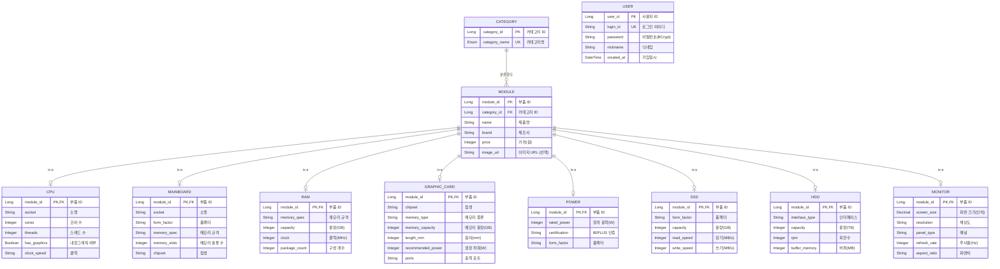

# 02. 개념 · 논리 · 물리 모델링

`backend/src/main/java/com/database_design/demo` 의 JPA 엔티티와
Flyway 마이그레이션(V1~V4)을 기준으로 정리한 데이터 모델이다.

| 대상 엔티티 | 테이블 | 소스 |
| --- | --- | --- |
| User | `users` | `domain/user/entity/User.java` |
| Category | `categories` | `domain/modules/common/entity/Category.java` |
| ProductModule (추상) | `modules` | `domain/modules/common/entity/ProductModule.java` |
| CPU | `cpus` | `domain/modules/CPU/entity/CPU.java` |
| MainBoard | `main_boards` | `domain/modules/MainBoard/entity/MainBoard.java` |
| Ram | `rams` | `domain/modules/Ram/entity/Ram.java` |
| GraphicCard | `graphic_cards` | `domain/modules/GC/entity/GraphicCard.java` |
| Power | `power` | `domain/modules/Power/entity/Power.java` |
| Ssd | `ssds` | `domain/modules/Ssd/entity/Ssd.java` |
| Hdd | `hdds` | `domain/modules/Hdd/entity/Hdd.java` |
| Monitor | `monitors` | `domain/modules/Monitor/entity/Monitor.java` |

---

## 1. 개념적 모델링 (Conceptual)

> 무엇을 저장하는가. 엔티티와 관계만 표현하고, 키·타입은 다루지 않는다.

### 1-1. 엔티티 정의

| 엔티티 | 설명 | 핵심 속성 |
| --- | --- | --- |
| 사용자 | 서비스 행동 주체(견적·질의를 만든 사람) | 로그인 아이디, 비밀번호, 닉네임, 가입일시 |
| 카테고리 | 부품 분류 8종 (CPU, MAINBOARD, RAM, GPU, POWER, SSD, HDD, MONITOR) | 카테고리명 |
| 부품 | 모든 부품의 공통 개념 (슈퍼타입) | 제품명, 제조사, 가격, 이미지 |
| CPU / 메인보드 / RAM / 그래픽카드 / 파워 / SSD / HDD / 모니터 | 부품의 하위 유형 (서브타입) | 유형별 고유 스펙 |

### 1-2. 관계 정의

| 관계 | 참여 엔티티 | 카디널리티 | 의미 |
| --- | --- | --- | --- |
| 분류된다 | 카테고리 – 부품 | 1 : N | 하나의 카테고리에 여러 부품이 속하고, 부품은 반드시 하나의 카테고리에 속한다 |
| IS-A | 부품 – 8개 하위 부품 | 1 : 1 (배타적·완전) | 부품은 정확히 하나의 하위 유형이다 |
| — | 사용자 | 독립 | 현재 다른 엔티티와 관계 없음 (견적·질의 로그는 계획 단계) |

### 1-3. 개념 ERD (Chen 표기)

---

## 2. 논리적 모델링 (Logical)

> 어떻게 구조화하는가. 식별자(PK)·외래키(FK)·정규화·슈퍼/서브타입 변환 방식을 정한다.
> DBMS에 종속된 물리 타입은 아직 쓰지 않는다.

### 2-1. 설계 결정

| 항목 | 결정 | 근거 |
| --- | --- | --- |
| 식별자 | 모든 엔티티에 대리키(Long) 사용 | `login_id`, `category_name` 은 UNIQUE 후보키로만 둔다 |
| 슈퍼/서브타입 변환 | **서브타입별 테이블 + 공통 테이블 (JOINED)** | 공통 속성(name, brand, price, image_url)을 한 곳에서 검색·정렬. 서브타입 컬럼은 모두 NOT NULL 유지 가능 |
| 서브타입 식별 | 서브타입 PK = 슈퍼타입 PK (**1:1 식별 관계**) | `module_id` 가 PK 이자 FK |
| 서브타입 구분자 | `modules.category_id` → `categories` | 별도 discriminator 컬럼 대신 카테고리 FK가 그 역할 |
| 정규형 | 3NF | 카테고리명을 별도 엔티티로 분리해 부품 행마다 중복 저장하지 않음 |

### 2-2. 논리 ERD (IE 표기)

> `||--o|` : MODULE 한 행은 8개 서브타입 중 **정확히 하나**에만 대응한다(배타적).
> Mermaid 로는 배타 제약을 직접 표현할 수 없으므로 도식에 "배타적 서브타입" 주석을 달 것.

---

## 3. 물리적 모델링 (Physical)

> 실제로 어떻게 저장하는가. MySQL 8 기준 타입·제약조건·인덱스·참조 동작까지 확정한다.

### 3-1. 환경

| 항목 | 값 |
| --- | --- |
| DBMS | MySQL 8.4 (docker-compose `mysql:8.4`) |
| 엔진 / 문자셋 | InnoDB / `utf8mb4` |
| DDL 소유 | Flyway (V1~V4), JPA 는 `ddl-auto: validate` |

### 3-2. 물리 ERD

```mermaid
erDiagram
    categories ||--o{ modules : "fk_modules_category"
    modules ||--o| cpus : "fk_cpus_module (CASCADE)"
    modules ||--o| main_boards : "fk_main_boards_module (CASCADE)"
    modules ||--o| rams : "fk_rams_module (CASCADE)"
    modules ||--o| graphic_cards : "fk_graphic_cards_module (CASCADE)"
    modules ||--o| power : "fk_power_module (CASCADE)"
    modules ||--o| ssds : "fk_ssds_module (CASCADE)"
    modules ||--o| hdds : "fk_hdds_module (CASCADE)"
    modules ||--o| monitors : "fk_monitors_module (CASCADE)"

    users {
        BIGINT user_id PK "AUTO_INCREMENT"
        VARCHAR_30 login_id UK "NOT NULL"
        VARCHAR_100 password "NOT NULL"
        VARCHAR_20 nickname "NOT NULL"
        DATETIME_6 created_at "NOT NULL"
    }
    categories {
        BIGINT category_id PK "AUTO_INCREMENT"
        VARCHAR_20 category_name UK "NOT NULL"
    }
    modules {
        BIGINT module_id PK "AUTO_INCREMENT"
        BIGINT category_id FK "NOT NULL, IDX"
        VARCHAR_100 name "NOT NULL, IDX"
        VARCHAR_50 brand "NOT NULL, IDX"
        INT price "NOT NULL"
        VARCHAR_500 image_url "NULL"
    }
    cpus {
        BIGINT module_id PK, FK "NOT NULL"
        VARCHAR_20 socket "NOT NULL"
        INT cores "NOT NULL"
        INT threads "NOT NULL"
        BIT_1 has_graphics "NOT NULL"
        VARCHAR_20 clock_speed "NOT NULL"
    }
    main_boards {
        BIGINT module_id PK, FK "NOT NULL"
        VARCHAR_20 socket "NOT NULL"
        VARCHAR_20 form_factor "NOT NULL"
        VARCHAR_10 memory_spec "NOT NULL"
        INT memory_slots "NOT NULL"
        VARCHAR_30 chipset "NOT NULL"
    }
    rams {
        BIGINT module_id PK, FK "NOT NULL"
        VARCHAR_10 memory_spec "NOT NULL"
        INT capacity "NOT NULL"
        INT clock "NOT NULL"
        INT package_count "NOT NULL"
    }
    graphic_cards {
        BIGINT module_id PK, FK "NOT NULL"
        VARCHAR_50 chipset "NOT NULL"
        VARCHAR_20 memory_type "NOT NULL"
        INT memory_capacity "NOT NULL"
        INT length_mm "NOT NULL"
        INT recommended_power "NOT NULL"
        VARCHAR_100 ports "NOT NULL"
    }
    power {
        BIGINT module_id PK, FK "NOT NULL"
        INT rated_power "NOT NULL"
        VARCHAR_20 certification "NOT NULL"
        VARCHAR_20 form_factor "NOT NULL"
    }
    ssds {
        BIGINT module_id PK, FK "NOT NULL"
        VARCHAR_20 form_factor "NOT NULL"
        INT capacity "NOT NULL"
        INT read_speed "NOT NULL"
        INT write_speed "NOT NULL"
    }
    hdds {
        BIGINT module_id PK, FK "NOT NULL"
        VARCHAR_20 interface_type "NOT NULL"
        INT capacity "NOT NULL"
        INT rpm "NOT NULL"
        INT buffer_memory "NOT NULL"
    }
    monitors {
        BIGINT module_id PK, FK "NOT NULL"
        DECIMAL_4_1 screen_size "NOT NULL"
        VARCHAR_30 resolution "NOT NULL"
        VARCHAR_20 panel_type "NOT NULL"
        INT refresh_rate "NOT NULL"
        VARCHAR_10 aspect_ratio "NOT NULL"
    }
```

> Mermaid 타입 표기에 괄호를 쓸 수 없어 `VARCHAR_30` = `VARCHAR(30)`, `DECIMAL_4_1` = `DECIMAL(4,1)`,
> `DATETIME_6` = `DATETIME(6)`, `BIT_1` = `BIT(1)` 로 적었다. 도구로 다시 그릴 때는 괄호 표기로 바꾼다.

### 3-3. 제약조건 · 인덱스 목록

| 테이블 | 이름 | 종류 | 대상 | 비고 |
| --- | --- | --- | --- | --- |
| users | PRIMARY | PK | `user_id` | AUTO_INCREMENT |
| users | `uk_users_login_id` | UNIQUE | `login_id` | 로그인 조회 |
| categories | PRIMARY | PK | `category_id` | |
| categories | `uk_categories_category_name` | UNIQUE | `category_name` | V3 에서 8행 시드 |
| modules | PRIMARY | PK | `module_id` | |
| modules | `fk_modules_category` | FK | `category_id` → `categories` | 참조 동작 기본값(RESTRICT) |
| modules | `idx_modules_category_id` | INDEX | `category_id` | 카테고리별 목록 |
| modules | `idx_modules_name` | INDEX | `name` | 제품명 검색 |
| modules | `idx_modules_brand` | INDEX | `brand` | 제조사 필터 |
| 8개 상세 테이블 | `fk_<table>_module` | PK + FK | `module_id` → `modules` | `ON DELETE CASCADE` |

### 3-4. 논리 → 물리 변환 시 확정한 사항

| 논리 | 물리 | 이유 |
| --- | --- | --- |
| Long 식별자 | `BIGINT AUTO_INCREMENT` | JPA `GenerationType.IDENTITY` |
| 상세 테이블 식별자 | `BIGINT` (자동증가 없음) | 부모 `modules.module_id` 값을 그대로 받음 |
| 카테고리명 Enum | `VARCHAR(20)` | `@Enumerated(EnumType.STRING)` — 순서 변경에 안전 |
| 가격 | `INT` (원 단위 정수) | 원화는 소수점이 없음 |
| 화면 크기 | `DECIMAL(4,1)` | 27.0, 34.5 같은 소수 1자리 정확 저장 |
| Boolean | `BIT(1)` | Hibernate 기본 매핑 |
| 가입일시 | `DATETIME(6)` | `LocalDateTime` 마이크로초 정밀도, `@CreatedDate` 자동 입력 |
| 서브타입 삭제 | `ON DELETE CASCADE` | 부품(modules) 삭제 시 상세 스펙도 함께 삭제 |

---

## 4. 도식 작성 시 참고 사항

- **users 는 다른 테이블과 연결이 없다.** 도식에서 독립 엔티티로 따로 두면 된다.
  (견적 `quotes`, 질의 로그 `llm_query_logs` 는 01 문서에서 계획만 세운 상태)
- **카테고리와 상세 테이블의 정합성은 DB 가 보장하지 않는다.** 예: `category_id = CPU` 인
  modules 행이 `rams` 에 들어가는 것을 막는 제약이 없고, 애플리케이션(서비스 계층)이 맞춰 넣는다.
  논리 모델 도식에 "배타적 서브타입 – 애플리케이션 보장" 으로 표기하면 정확하다.
- **용량 단위가 테이블마다 다르다.** `ssds.capacity`·`rams.capacity` 는 GB, `hdds.capacity` 는 TB.
  물리 도식의 컬럼 주석에 단위를 같이 적는 것을 권장한다.
- 테이블명 `power` 만 단수형이다 (나머지는 복수형).
- `BaseProductDetail`, `ProductCategory` 는 각각 응답 DTO 인터페이스·Enum 이라 테이블이 아니다.
