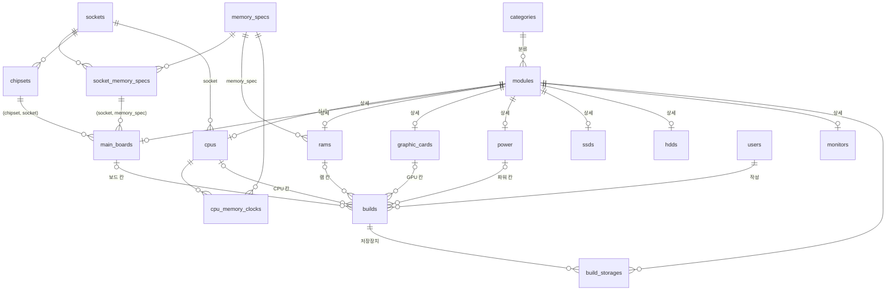

# 05. V7 스키마 구조

[`V7__add_component_constraints.sql`](../../backend/src/main/resources/db/migration/V7__add_component_constraints.sql)까지
적용한 스키마의 테이블·뷰 구조다. 규칙의 근거와 설계 이유는 [04-부품별-제약조건.md](./04-부품별-제약조건.md)에 있다.

- ★ V7에서 새로 생긴 테이블
- 🆕 V7에서 기존 테이블에 추가된 컬럼

기존 `users`, `nl_queries`, `nl_query_modules`는 V7에서 바뀌지 않았다. `builds.user_id`가 `users`를 참조한다.

## ERD

`warning_rules`는 다른 테이블과 FK로 연결되지 않는다. 경고 뷰의 `warning_code`와 조인해 벌점과 문구를 얻는다.

## 1. 공통·부품 상세 테이블

| 테이블 | 주요 컬럼 | 키·제약 |
| --- | --- | --- |
| `categories` | category_id, category_name | PK category_id |
| `modules` | module_id, category_id, name, brand, price, performance_score, image_url | PK module_id, FK → categories |
| `cpus` | module_id, socket, cores, threads, has_graphics, clock_speed, 🆕tdp_watt, 🆕overclockable | PK·FK module_id, FK socket → sockets |
| `main_boards` | module_id, socket, form_factor, memory_spec, memory_slots, 🆕max_memory_gb, 🆕has_video_output, chipset | FK (socket, memory_spec) → socket_memory_specs, FK (chipset, socket) → chipsets |
| `rams` | module_id, memory_spec, capacity, clock, package_count | FK memory_spec → memory_specs |
| `graphic_cards` | module_id, chipset, memory_type, memory_capacity, length_mm, recommended_power, 🆕uses_16pin, 🆕pcie_8pin_count, ports | PK·FK module_id |
| `power` | module_id, rated_power, 🆕has_16pin, 🆕pcie_8pin_count, certification, form_factor | PK·FK module_id |
| `ssds` | module_id, form_factor, capacity, read_speed, write_speed | PK·FK module_id |
| `hdds` | module_id, interface_type, capacity, rpm, buffer_memory | PK·FK module_id |
| `monitors` | module_id, screen_size, resolution, panel_type, refresh_rate, aspect_ratio | PK·FK module_id |

숫자 스펙에는 값 제약 `CHECK`(가격 ≥ 0, 코어·용량·속도 > 0, 스레드 ≥ 코어 등)가 걸려 있다.

🆕 컬럼의 NULL 정책:

| 컬럼 | NULL | 기본값 | 비고 |
| --- | --- | --- | --- |
| `cpus.tdp_watt`, `cpus.overclockable` | 허용 | — | 모르면 W4·W5 경고를 내지 않음 |
| `main_boards.max_memory_gb`, `has_video_output` | 허용 | — | 모르면 B8·B9를 판정하지 않음 |
| `graphic_cards.uses_16pin`, `pcie_8pin_count` | 불가 | 0 | 기존 행·API 등록 행은 0 |
| `power.has_16pin`, `pcie_8pin_count` | 불가 | 0 | 기존 행·API 등록 행은 0 |

## 2. 조회 테이블 (A)

| 테이블 | 컬럼 | 키 | 초기 데이터 |
| --- | --- | --- | --- |
| ★`sockets` | socket | PK | LGA1700, AM4, AM5 |
| ★`memory_specs` | memory_spec | PK | DDR4, DDR5 |
| ★`socket_memory_specs` | socket, memory_spec | PK (socket, memory_spec) | LGA1700-DDR4/DDR5, AM4-DDR4, AM5-DDR5 |
| ★`chipsets` | chipset, socket, supports_cpu_oc, rated_cpu_tdp_watt | PK chipset, UNIQUE (chipset, socket) | 20종 (LGA1700 7, AM5 9, AM4 4) |
| ★`cpu_memory_clocks` | cpu_id, memory_spec, max_clock_2dimm, max_clock_4dimm | PK (cpu_id, memory_spec), FK → cpus (ON DELETE CASCADE) | 시드로 입력 |

## 3. 견적 (B)

| 테이블 | 컬럼 | 키·제약 |
| --- | --- | --- |
| ★`builds` | build_id, user_id, title, status (`DRAFT`/`COMPLETE`), created_at | PK build_id, FK user_id → users (ON DELETE CASCADE) |
| | CPU 칸: cpu_id, cpu_socket, cpu_has_graphics | 복합 FK → cpus |
| | 보드 칸: board_id, board_socket, board_memory_spec, board_memory_slots | 복합 FK → main_boards |
| | 보드 한도 칸: board_max_memory_gb, board_has_video_output | 복합 FK → main_boards (NULL 허용이라 따로 묶음) |
| | 램 칸: ram_id, ram_memory_spec, ram_package_count, ram_capacity, ram_quantity | 복합 FK → rams |
| | GPU 칸: gpu_id, gpu_recommended_power, gpu_uses_16pin, gpu_pcie_8pin_count | 복합 FK → graphic_cards |
| | 파워 칸: power_id, power_rated_power, power_has_16pin, power_pcie_8pin_count | 복합 FK → power |
| ★`build_storages` | build_id, module_id, quantity | PK (build_id, module_id), FK → builds (ON DELETE CASCADE), FK → modules |

`builds`의 각 칸은 부품 id와 비교에 쓸 스펙을 함께 저장한다. 복합 FK가 그 스펙이 원본 부품과 같은지
보장하고, `CHECK`가 같은 행 안에서 호환성을 비교한다. 복합 FK의 참조 대상으로 상세 테이블에 UNIQUE 키
(`uk_cpus_compat`, `uk_main_boards_compat`, `uk_main_boards_limits`, `uk_rams_compat`, `uk_graphic_cards_compat`,
`uk_power_compat`)를 추가했다.

부품 칸의 FK는 참조 동작이 기본값(RESTRICT)이다. 견적에 담긴 부품은 삭제하거나 비교 스펙을 수정할 수 없다.

### `builds`의 CHECK 제약

| 제약 | 내용 |
| --- | --- |
| `ck_builds_status` | status는 `DRAFT` 또는 `COMPLETE` |
| `ck_builds_ram_quantity_positive` | 램 수량 > 0 |
| `ck_builds_*_pair` (6개) | id와 복사한 스펙을 함께 채우거나 함께 비움. 복합 FK를 NULL로 우회하는 것을 막음 |
| `ck_builds_b1_socket` | B1: CPU 소켓 = 보드 소켓 |
| `ck_builds_b2_memory_spec` | B2: 램 규격 = 보드 메모리 규격 |
| `ck_builds_b3_memory_slots` | B3: 램 모듈 수 × 수량 ≤ 보드 슬롯 수 |
| `ck_builds_b5_power` | B5: 파워 정격 ≥ 그래픽카드 권장 파워 |
| `ck_builds_b6_complete` | B6(B4 포함): 완성 견적에 CPU·보드·램·파워가 있고, 그래픽카드가 있거나 CPU에 내장 그래픽이 있음 |
| `ck_builds_b7_power_connector` | B7: 파워 8핀 수 ≥ 카드 요구 8핀 수, 또는 16핀 카드 + 16핀 파워 |
| `ck_builds_b8_memory_capacity` | B8: 램 총 용량 ≤ 보드 최대 용량 (보드 값이 NULL이면 판정 안 함) |
| `ck_builds_b9_video_output` | B9: 그래픽카드 없이 완성하면 보드에 영상 출력 단자 필요 (NULL이면 판정 안 함) |

## 4. 경고 (W)

| 테이블 | 컬럼 | 키 |
| --- | --- | --- |
| ★`warning_rules` | warning_code, penalty, message, how_to_avoid | PK warning_code |

| warning_code | 상황 | penalty |
| --- | --- | --- |
| W1 | 램 클럭 > CPU 공식 지원 클럭 | 0 (안내만) |
| W2 | 램 4개 장착으로 공식 지원 클럭 하락 | 20 |
| W3 | 램 1개라 싱글 채널 | 30 |
| W4 | 오버클럭 CPU + CPU 오버클럭 불가 칩셋 | 20 |
| W5 | CPU TDP > 칩셋이 상정하는 TDP | 20 |

## 5. 뷰

| 뷰 | 반환 컬럼 | 용도 |
| --- | --- | --- |
| `v_cpu_board_compat` | cpu_id, board_id | B1 호환 쌍 |
| `v_ram_board_compat` | ram_id, board_id, max_kits | B2·B3·B8 호환 쌍과 최대 세트 수 |
| `v_cpu_ram_compat` | cpu_id, ram_id | 보드 선택 전 CPU 소켓에 맞는 램 |
| `v_gpu_power_compat` | gpu_id, power_id | B5·B7 호환 쌍 |
| `v_cpu_board_warnings` | cpu_id, board_id, warning_code | W4·W5 (부품 쌍 단위) |
| `v_cpu_ram_warnings` | cpu_id, ram_id, warning_code | W1·W2·W3 (키트 하나 기준) |
| `v_build_warnings` | build_id, warning_code | 저장된 견적의 경고 (수량 반영) |

판별 뷰(`*_compat`)는 호환되는 쌍만 돌려준다. 뷰에 없는 쌍은 하드 규칙 위반이다. 경고 뷰는
`warning_rules`와 조인해 벌점 합계로 후보를 정렬하는 데 쓴다(04 문서 5-3).
